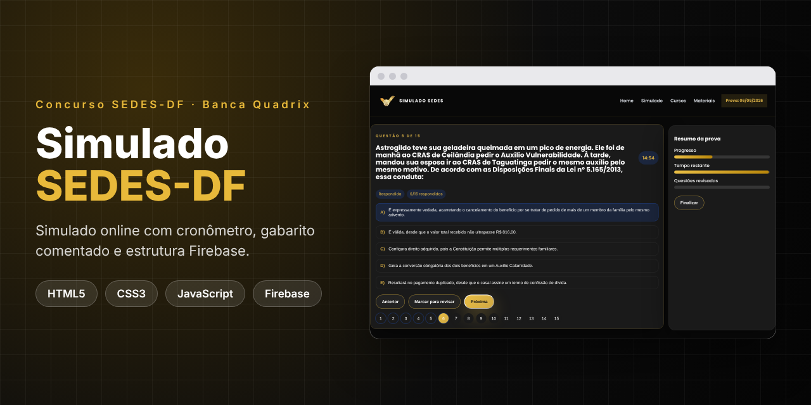
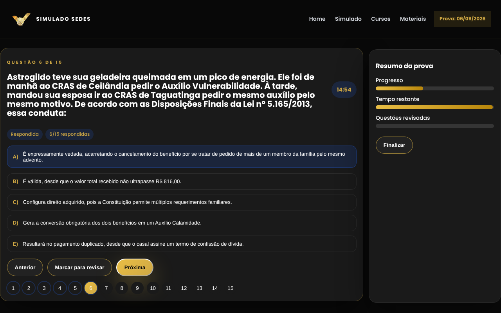
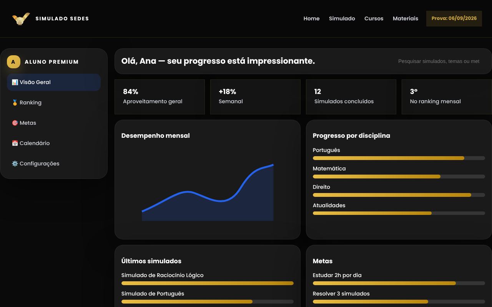
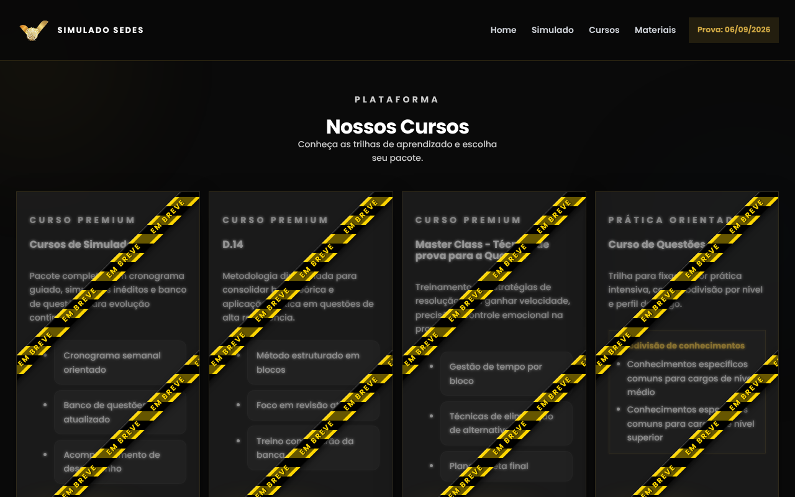
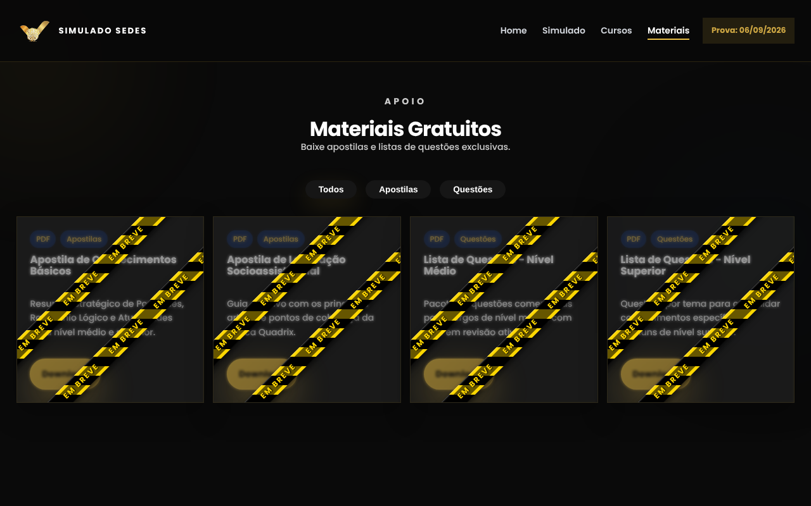

<p align="center">
  
</p>

<h1 align="center">🎯 Simulado SEDES-DF — Plataforma de Concursos</h1>

<p align="center">
  Plataforma web de preparação para o concurso da <b>SEDES-DF</b> (Secretaria de Estado de Desenvolvimento Social
  do Distrito Federal), com foco na banca <b>Quadrix</b>: simulado com cronômetro e gabarito comentado, planos de
  assinatura, cursos, materiais e uma base de backend em <b>Firebase</b>.
</p>

<p align="center">
  
  
  
  
  
  
  
</p>

<p align="center">
  <a href="#-sobre-o-projeto">Sobre</a> •
  <a href="#-funcionalidades">Funcionalidades</a> •
  <a href="#%EF%B8%8F-telas">Telas</a> •
  <a href="#-como-executar">Como executar</a> •
  <a href="#-arquitetura-firebase">Firebase</a> •
  <a href="#-deploy">Deploy</a> •
  <a href="#-estrutura-do-projeto">Estrutura</a> •
  <a href="#%EF%B8%8F-tecnologias">Tecnologias</a>
</p>

---

## 📌 Sobre o projeto

O **Simulado SEDES-DF** é uma plataforma educacional voltada à preparação para o concurso público da SEDES-DF,
com prova prevista para **06/09/2026**. O projeto é do **Prof. Betão** e reúne:

- simulado interativo com questões no estilo da banca Quadrix, cronômetro e gabarito comentado;
- landing page com benefícios, depoimentos, resultados de alunos, FAQ e planos de assinatura;
- páginas de cursos, materiais gratuitos e mentoria;
- uma camada de backend em **Firebase** (Authentication, Firestore, Storage e Cloud Functions) com regras de
  segurança por papel de usuário.

O frontend é estático (HTML, CSS e JavaScript sem framework) e roda direto no navegador.

## ✨ Funcionalidades

| | Recurso | Descrição |
|---|---|---|
| 🏠 | **Landing page** | Benefícios, recursos, planos em carrossel (Swiper), resultados de alunos com lightbox e FAQ |
| 💳 | **Planos** | Cada plano abre um modal de confirmação e leva ao checkout externo de pagamento |
| 📝 | **Simulado** | 15 questões por tentativa (banco de 20 em `script.js`), com navegação direta para qualquer questão |
| ⏱️ | **Cronômetro** | 15 minutos, barras de progresso e de tempo; ao zerar, a prova é finalizada automaticamente |
| 🔖 | **Marcar para revisar** | Questões marcadas aparecem destacadas e entram no resumo da prova |
| 💾 | **Progresso salvo** | Respostas e tempo ficam no `localStorage`, então recarregar a página não perde a prova |
| 📊 | **Resultado** | Percentual, acertos, erros, brancos, tempo restante e revisão de cada questão com comentário |
| 📈 | **Painel do aluno** | Layout de dashboard com desempenho, disciplinas, últimos simulados e metas (dados de exemplo) |
| 🎓 | **Cursos e materiais** | Catálogo de cursos e biblioteca de PDFs com filtros, marcados como "Em breve" |
| 🔐 | **Módulo de autenticação** | `auth.js` com cadastro, login, logout, verificação de e-mail, recuperação de senha e perfil no Firestore |
| 🛡️ | **Regras de segurança** | `firestore.rules` e `storage.rules` com validação de campos e acesso por papel |
| ☁️ | **Cloud Functions** | Auditoria de escritas, backup diário do Firestore e criptografia de CPF |

> ℹ️ O módulo `auth.js` está pronto, mas ainda não é carregado pelas páginas, e as credenciais do Firebase estão
> com valores de exemplo (`YOUR_API_KEY`, `YOUR_FIREBASE_PROJECT_ID`). O simulado funciona sem backend.

## 🖼️ Telas

<table>
  <tr>
    <td align="center"><b>Página inicial</b><br></td>
    <td align="center"><b>Simulado</b><br></td>
  </tr>
  <tr>
    <td align="center"><b>Resultado e gabarito</b><br></td>
    <td align="center"><b>Painel do aluno</b><br></td>
  </tr>
  <tr>
    <td align="center"><b>Cursos</b><br></td>
    <td align="center"><b>Materiais</b><br></td>
  </tr>
  <tr>
    <td align="center" colspan="2"><b>Celular</b><br></td>
  </tr>
</table>

## 🚀 Como executar

### Só o site

Não há build nem dependências no frontend:

```bash
git clone https://github.com/kauaxp77/simulados-sedes-df.git
cd simulados-sedes-df
```

Abra o `index.html` no navegador (as páginas, o simulado e o resultado funcionam abrindo os arquivos direto).
Se preferir um servidor local (depois acesse http://localhost:8000):

```bash
python3 -m http.server 8000
```

### Com Firebase

Pré-requisitos: [Node.js](https://nodejs.org/) 20+ e [Firebase CLI](https://firebase.google.com/docs/cli).

```bash
npm install -g firebase-tools
firebase login
```

1. Em `.firebaserc`, troque `YOUR_FIREBASE_PROJECT_ID` pelo ID do seu projeto.
2. Em `auth.js`, preencha o `firebaseConfig` com os dados do app web (Console do Firebase → Configurações do
   projeto → Seus apps).
3. Instale as dependências das functions:

   ```bash
   cd functions
   npm install
   ```

4. Configure as variáveis das Cloud Functions:

   | Variável | Descrição |
   |---|---|
   | `CPF_SECRET` | Chave AES-256 (64 caracteres hexadecimais) usada por `encryptCpf` |
   | `BACKUP_BUCKET` | Bucket do Google Cloud Storage que recebe o backup diário |

5. Rode os emuladores:

   ```bash
   firebase emulators:start
   ```

   | Serviço | Porta |
   |---|---|
   | Hosting | http://localhost:5000 |
   | Cloud Functions | http://localhost:5001 |
   | Firestore | http://localhost:8080 |

> Os comandos do Firebase seguem a configuração do repositório (`firebase.json`); eles não foram executados contra um
> projeto real.

## 🔥 Arquitetura Firebase

```
Firebase Project
├── Authentication      → login por e-mail/senha com verificação de e-mail
├── Cloud Firestore     → usuários, simulados, questões, redações, resultados, assinaturas e logs
├── Firebase Storage    → fotos de perfil e arquivos de simulado
├── Cloud Functions     → auditoria, backup diário e criptografia de CPF
└── Firebase Hosting    → entrega do frontend estático
```

### Coleções do Firestore

#### `users`
Perfis dos usuários cadastrados.

| Campo | Tipo | Descrição |
|---|---|---|
| `name` | string | Nome completo |
| `email` | string | E-mail |
| `cpfEncrypted` | string | CPF protegido |
| `phone` | string | Telefone |
| `role` | string | `admin`, `professor`, `monitor`, `aluno`, `visitante` |
| `plan` | string | Plano ativo (`gratuito`, `premium` etc.) |
| `paymentStatus` | string | `paid`, `pending`, `cancelled` |
| `status` | string | `active`, `inactive` |
| `permissions` | map | Permissões personalizadas |
| `createdAt` / `updatedAt` / `lastLogin` | timestamp | Datas de cadastro, atualização e último acesso |
| `photoUrl` | string | URL da foto de perfil |

#### `simulados`
Configuração dos simulados: `name`, `category`, `exam`, `position`, `description`, `questionCount`, `weight`,
`durationMinutes`, `professorId`, `status` (`draft`, `published`, `archived`), `tags` e `createdAt`.

#### `questoes`
Banco de questões reutilizáveis: `question`, `options` (mínimo 2), `correctAnswer`, `explanation`, `subject`,
`difficulty` (`easy`, `medium`, `hard`), `weight`, `authorId`, `createdAt` e `updatedAt`.

#### `redacoes`, `resultados`, `assinaturas` e `logs`
Redações enviadas para correção, histórico de tentativas e pontuações, assinaturas e pagamentos, e a trilha de
auditoria das operações.

### Regras de segurança

| Coleção | Leitura | Escrita |
|---|---|---|
| `users` | Próprio usuário ou admin | Próprio usuário ou admin (exclusão só admin) |
| `simulados` | Usuários autenticados | Admin ou professor responsável |
| `questoes` | Usuários autenticados | Admin ou professor autor |
| `redacoes` | Autor, admin ou professor responsável | Criação pelo autor; correção por admin ou professor |
| `resultados` | Dono, professor responsável ou admin | Criação pelo dono ou admin |
| `assinaturas` | Dono ou admin | Criação pelo dono ou admin; alteração só admin |
| `logs` | Apenas admin | Criação do próprio log; nunca editável |
| Demais caminhos | Bloqueado | Bloqueado |

No Storage, cada usuário envia só a própria foto de perfil (imagem de até 5 MB) e apenas admin/professor enviam
arquivos de simulado.

### Cloud Functions (`functions/index.js`)

| Função | Gatilho | Descrição |
|---|---|---|
| `createAuditLog` | Firestore `onWrite` | Registra criação, atualização e exclusão de documentos em `logs` |
| `backupFirestore` | Agendada (a cada 24h) | Exporta o Firestore para o bucket de backup |
| `encryptCpf` | HTTPS Callable | Criptografa o CPF com AES-256-GCM usando `CPF_SECRET` |
| `restoreBackup` | HTTPS Callable | Restrita a admin; a restauração em si ainda está por implementar |

### Papéis de usuário

| Papel | Permissões |
|---|---|
| `admin` | Acesso total a recursos e dados |
| `professor` | Cria e edita os próprios simulados e questões; vê resultados dos seus alunos |
| `monitor` | Suporte aos alunos |
| `aluno` | Faz simulados, acessa materiais e cursos, vê o próprio desempenho |
| `visitante` | Apenas conteúdo público |

Os papéis são lidos do token de autenticação (`request.auth.token.role`).

Documentação complementar: [`docs/FIREBASE_ARCHITECTURE.md`](docs/FIREBASE_ARCHITECTURE.md),
[`docs/README_FIREBASE.md`](docs/README_FIREBASE.md) e
[`docs/auditoria-seguranca-firebase.md`](docs/auditoria-seguranca-firebase.md).

## 🌐 Deploy

**Firebase Hosting** (comandos indicados pela configuração; não executados aqui):

```bash
firebase deploy                                     # hosting + functions + regras
firebase deploy --only hosting
firebase deploy --only functions
firebase deploy --only firestore:rules,storage:rules
```

O `firebase.json` publica a raiz do projeto e ignora `functions/`, regras, arquivos ocultos, `*.md` e `docs/`.

**Vercel**: o `vercel.json` ativa URLs limpas e devolve 404 para `firebase.json`, `.firebaserc`, regras,
`functions/` e arquivos `.md`, para que não fiquem públicos.

## 📁 Estrutura do projeto

```
simulados-sedes-df/
├── index.html            # Landing page
├── simulados.html        # Apresentação do simulado
├── simulado.html         # Simulado interativo
├── resultado.html        # Resultado e gabarito comentado
├── dashboard.html        # Painel do aluno
├── cursos.html           # Catálogo de cursos
├── materiais.html        # Biblioteca de materiais
├── mentoria.html         # Mentoria (em construção)
├── script.js             # Menu, FAQ, simulado, resultado, modais e animações
├── cursos.js             # Lógica da página de cursos
├── materiais.js          # Lógica da biblioteca de materiais
├── auth.js               # Módulo de autenticação Firebase (ES module)
├── styles.css            # Estilos globais
├── assets/               # Logo, fotos do professor, resultados de alunos e PDFs
├── functions/
│   ├── index.js          # Cloud Functions
│   └── package.json
├── docs/                 # Documentação Firebase, banner e prints
├── firebase.json         # Hosting, functions, regras e emuladores
├── firestore.rules       # Regras do Firestore
├── storage.rules         # Regras do Storage
├── .firebaserc           # Projeto Firebase padrão
└── vercel.json           # Rotas e bloqueios na Vercel
```

## 🛠️ Tecnologias

- **HTML5, CSS3 e JavaScript** sem framework, fontes **Inter**, **Manrope** e **Poppins**
- **Swiper 10** no carrossel de planos
- **Firebase**: Authentication, Cloud Firestore, Storage, Hosting e Security Rules (SDK web 10.11)
- **Cloud Functions** em Node.js 20 (`firebase-functions` e `firebase-admin`)
- **Vercel** como alternativa de hospedagem estática

## 👨‍💻 Autor

Desenvolvido por **[kauaxp77](https://github.com/kauaxp77)** para o Prof. Betão — Preparatório SEDES-DF.

<p align="center">⭐ Se curtiu o projeto, deixe uma estrela!</p>
